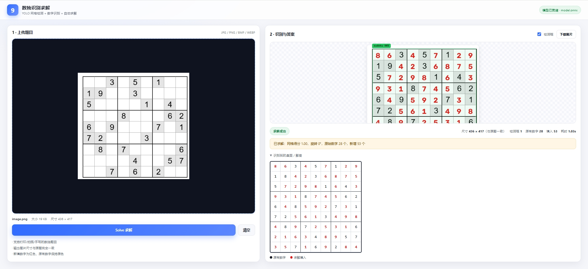

[中文](README.md) | [English](README_EN.md)

# Sudoku Solver

A complete **"upload / shoot a photo → locate the sudoku grid → read the digits → solve it → draw the answer back onto the image"** pipeline, driven by two small local models:

| Stage | Model | Notes |
| --- | --- | --- |
| Grid detection | `models/best.onnx-quant-ir9.onnx` | YOLOv8 single-class detector, quantised to ONNX (IR9); fast enough on CPU |
| Digit recognition | `models/digit_recognize_model.onnx` | 28×28 single-character classifier, outputs class scores for digits 1–9 |

Both models are quantised and only need `onnxruntime` at runtime. With `onnxruntime-gpu` installed, digit recognition automatically uses CUDA while the detector stays on CPU (the quantised model is faster and more stable there).

Apart from the models, grid search, perspective correction, cell slicing and the solver are all plain OpenCV + NumPy — no YOLO Python package, no deep-learning framework.

## Directory layout

```
sudoku_solver/
├── app/                        # Web app (FastAPI + static page)
│   ├── server.py               # Service entry: /, /api/health, /api/solve
│   ├── pipeline.py             # Web pipeline: detector boxes + classical contours as twin candidate sources, answer drawn back onto the original image
│   ├── detector.py             # YOLOv8 ONNX detector wrapper (letterbox / NMS / coordinate restore)
│   ├── sudoku_utils.py         # Core algorithms: grid candidates, perspective correction, cell slicing, digit recognition, solver
│   ├── static/                 # Frontend (index.html / app.js / style.css, no build step)
│   ├── requirements.txt        # Python dependencies for the app directory
│   └── website_demo.png        # UI screenshot
├── main.py                     # CLI batch mode: solve every image in a directory and save the results
├── utils.py                    # Algorithms used by the CLI (same lineage as app/sudoku_utils.py)
├── models/                     # Models and export/quantisation scripts
│   ├── best.onnx-quant-ir9.onnx    # Grid detector (quantised, for deployment)
│   ├── digit_recognize_model.onnx  # Digit recogniser (for deployment)
│   ├── export_yolopt_to_onnx.py    # .pt -> .onnx export
│   ├── onnx_quant_ir9.py           # ONNX quantisation (IR9)
│   └── load_onnx_ir9_det.py        # Reference loader / inference for the quantised detector
├── misc/                       # Legacy versions and experiments (src_tf / src_onnx, YOLO export notes)
└── mobile/                     # Mobile: pure-frontend PWA + Capacitor Android (not version-controlled, see .gitignore)
   ├── index.html               # App entry point
   ├── src/core/                # Pure algorithms: detection, warping, cell slicing, recognition, solving (no UI dependency)
   ├── src/app/                 # UI and state management
   ├── models/                  # The two quantised ONNX weights used on mobile + manifest.json
   ├── scripts/build-web.mjs    # Produces the dist/ directory for Capacitor
   └── android/                 # Capacitor-generated Android project
```

> `mobile/` is a separate mobile project (Capacitor + Android). It is large and is not part of this repository's commit content — it is excluded as a whole in `.gitignore`, while the source and notes stay in that directory of the local workspace.

## Requirements

- Python 3.9+ (3.10 / 3.11 recommended)
- No GPU required; install `onnxruntime-gpu` if you have an NVIDIA card and want faster digit recognition

## Installation

```bash
# A dedicated environment is recommended
conda create -n sudoku python=3.11 -y
conda activate sudoku

pip install -r app/requirements.txt
# GPU build (optional, mutually exclusive with onnxruntime):
# pip uninstall -y onnxruntime && pip install onnxruntime-gpu
```

## Running the web app

```bash
python app/server.py --host 127.0.0.1 --port 8000
# Auto-reload during development:
# python app/server.py --host 127.0.0.1 --port 8000 --reload
```

Open <http://127.0.0.1:8000> and drop in or pick a sudoku image. The page needs no build step — `app/static/` is served directly.



### API

| Method | Path | Description |
| --- | --- | --- |
| GET | `/` | Frontend page |
| GET | `/api/health` | Health check; reports whether the models loaded |
| POST | `/api/solve` | Upload an image in the `file` form field, returns JSON |

Response of `/api/solve`:

```jsonc
{
  "ok": true,                 // whether the puzzle was solved
  "message": "已求解：网格得分 0.93，旋转 0°，原始数字 28 个，新增 53 个",
  "seconds": 1.27,            // server-side elapsed time
  "width": 1000, "height": 1000,
  "boxes": [                  // detected grid boxes
    {"x": 12, "y": 8, "w": 976, "h": 980, "score": 0.94, "label": "sudoku"}
  ],
  "givens": 28,               // number of recognised givens
  "filled": 53,               // number of digits filled in by the solver
  "board": [[...9x9...]],     // recognised puzzle (0 = empty cell)
  "solved_board": [[...9x9...]], // solution
  "image": "data:image/png;base64,..." // image with answers drawn on, same size as the input
}
```

On failure `ok=false` and `message` explains why (no grid found / fewer than 17 digits recognised / unsolvable / timeout). The HTTP status may still be 200, so the frontend should branch on `ok`.

## Mobile (`mobile/`)

A **pure-frontend mobile app** with the same feature set as the web version: take or pick a photo → detect the grid → read the digits → solve → overlay the answers on the original photo.
All inference runs inside the browser / WebView via `onnxruntime-web` (WASM) — **no backend, works offline**.

**Features**

- Import from the photo library or camera (`<input capture>`, drag & drop also works); a built-in "sample puzzle" for a one-tap trial
- Progress feedback while solving, with explicit failure reasons (no grid found / fewer than 17 digits / unsolvable / timeout)
- Two result views: **answer image** (red digits over the photo) and **board** (9×9 table plus stats)
- One-tap save of the answer image
- The same pair of models ships with the app: `models/grid_detector_yolov8n_640_int8.onnx` (3.28 MB) and `models/digit_classifier_28x28.onnx` (132 KB), about 3.4 MB in total

**How it is built**

- `src/core/` reimplements the `app/pipeline.py` algorithms in vanilla JS: YOLOv8 pre/post-processing + NMS, quad ordering and perspective transform, 81-cell slicing with grid-line erasing, 28×28 mask recognition, bitmask backtracking solver with "swap low-confidence digits for their runner-up class" retries, and four rotation attempts.
- On mobile the detector's quad is used directly, so the desktop version's classical contour search is skipped; **OpenCV.js is deliberately not bundled** (~8 MB) — warping and cell slicing use Canvas plus typed arrays.
- The frontend needs no build step: `index.html` + `assets/` + `src/` run as-is; `node scripts/build-web.mjs` copies the runnable files (including `models/`) into `dist/` for Capacitor packaging.
- The Android shell is generated by Capacitor (app ID `com.nextwork.sudoku`, app name「数独识别求解」).

**Local preview** (inside the `mobile/` directory)

```bash
npm install          # install onnxruntime-web and Capacitor dependencies
npm start            # node server.mjs, then open the printed URL in a browser
```

Android packaging: run `node scripts/build-web.mjs` first to copy the frontend and models into `dist/`, then sync and build the Android project with Capacitor (`mobile/android/` is already generated; see `mobile/README.md` for details).

**Acceptance criteria**: for the same test image (`../.test_input/15.jpg`) the output should match the Python result recorded in `mobile/docs/baseline.json` — grid score 0.9935, rotation 0°, 25 givens.

> The mobile project is separate and not part of this repository's commit content; the commands above are documentation only and should be verified in its own environment.

## CLI batch mode

```bash
python main.py --model_fpath models/digit_recognize_model.onnx --input_dir ./samples --output_dir ./out
```

| Option | Description |
| --- | --- |
| `--input_dir` | Directory of images to process (jpg/png/bmp/tiff/webp) |
| `--output_dir` | Where the result images are saved |
| `--model_fpath` | Digit-model path; defaults to `src_onnx/model.onnx` (**legacy path — pass `models/digit_recognize_model.onnx` explicitly**) |
| `--debug_dir` | Optional; writes a debug image for every failed puzzle |
| `--time_budget` | Max seconds per image (default 20) |

> Note: the default in `main.py` is still the legacy `src_onnx/model.onnx`, and the script contains a debug-only early exit `if i==5: break`. Adjust both before running a real batch.

## Pipeline

1. **Grid candidates**: pad the image with a 24 px white frame so grids touching the border still have a closed outline; then generate candidate quads with 5 binarisation strategies (adaptive mean/Gaussian, CLAHE, Otsu, Canny) plus contour / convex-hull / min-area-rect extraction, and add the whole image as a fallback candidate.
2. **Scoring**: warp each candidate to 720×720, compare the horizontal/vertical line profiles against the 10 evenly spaced grid lines to get a grid score, and keep the best few candidates.
3. **Cell slicing**: detect 10 horizontal and 10 vertical lines on the rectified board (falling back to equal spacing), slice out 81 cells, and erase the grid lines so they are not mistaken for digits.
4. **Digit recognition**: decide whether a cell holds a digit via connected components, normalise it to 28×28, and feed it to the ONNX classifier to get 9 class scores.
5. **Solving**: bitmask + MRV-heuristic backtracking with node and time limits. Fewer than 17 recognised digits is treated as invalid; when unsolvable, the least-confident digits are swapped to their runner-up class and retried, and 90°/180°/270° rotations are attempted.
6. **Drawing back**: answers are drawn in red only into originally empty cells; the web version renders them onto a canvas the same size as the input image.

## Known issues

- **Moiré patterns** from photographing a computer screen break grid detection; extra moiré-removal pre-processing is needed.
- Handwriting, low resolution, strong perspective and curved book pages all hurt digit recognition; de-warping beforehand helps.
- The solver is sensitive to a single misrecognised digit. The confidence-based retry strategy mitigates this, but hard puzzles can take noticeably longer.

## References

- Model export and quantisation details: `misc/yolo-export.md`, `misc/src_onnx/README.md`, `misc/src_tf/README.md`